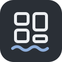
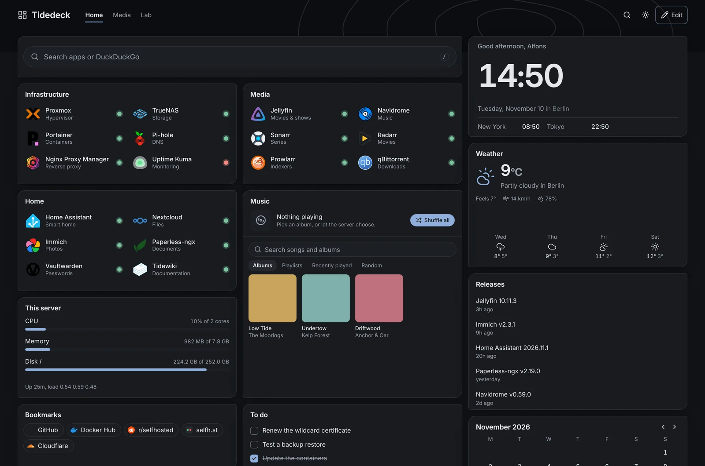
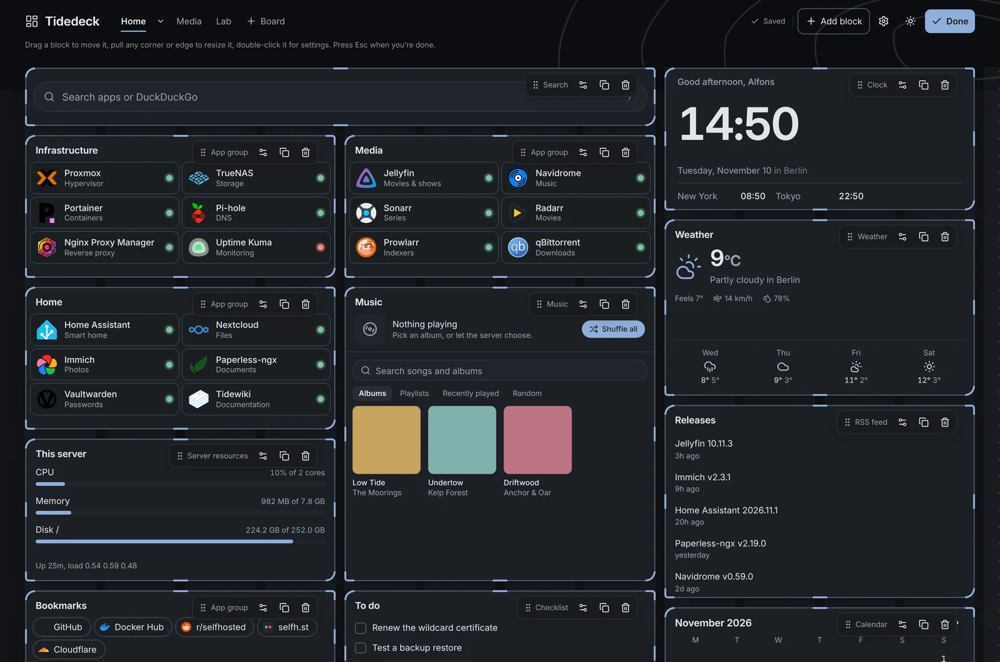
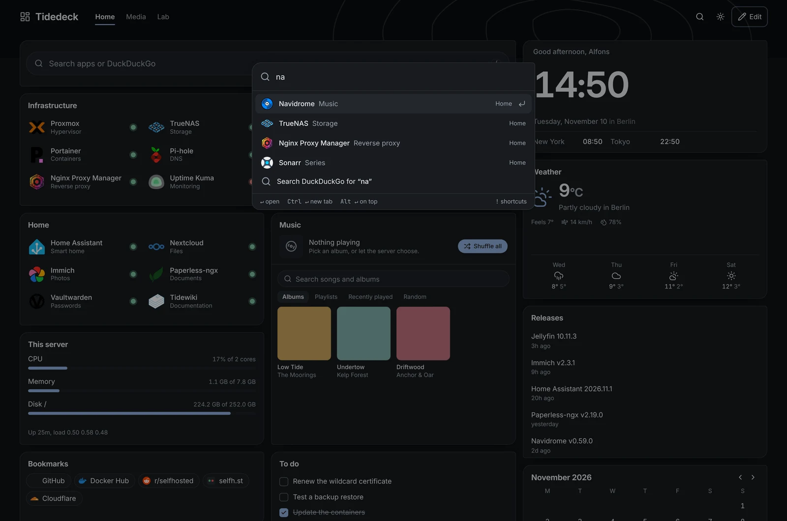
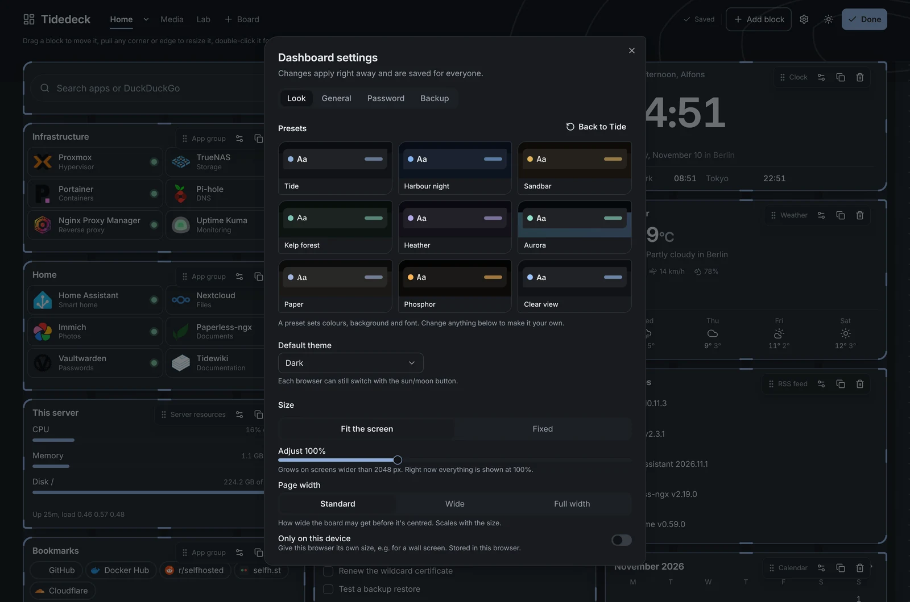
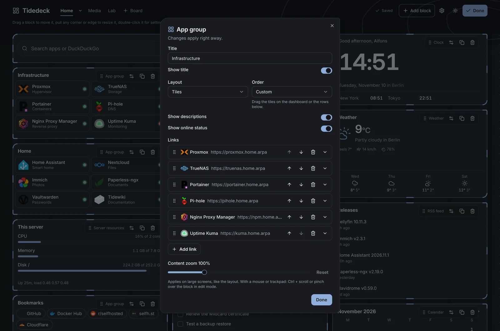
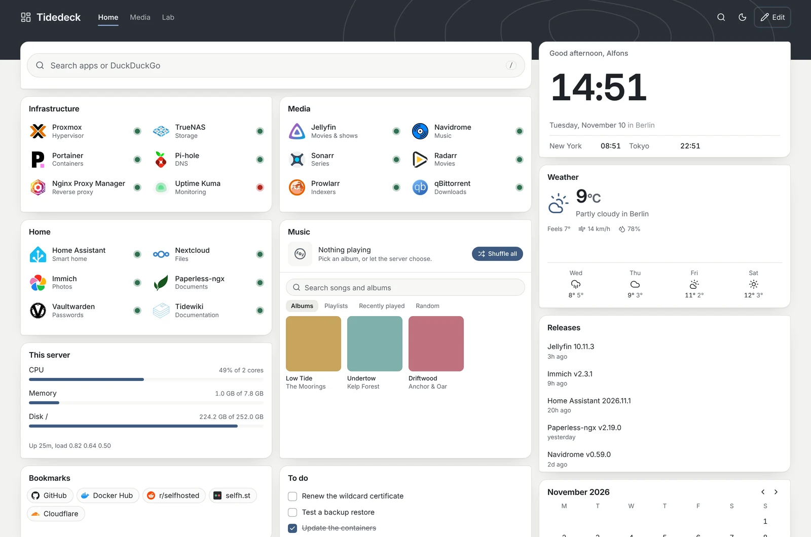
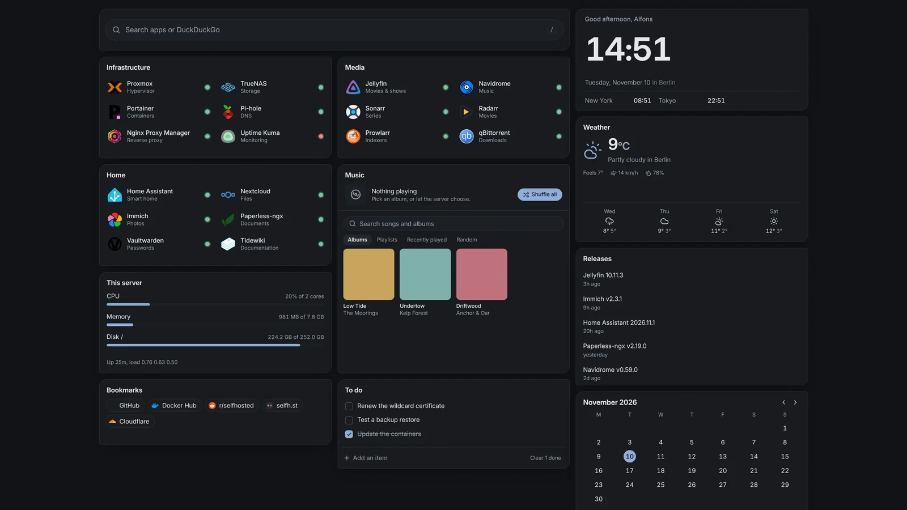
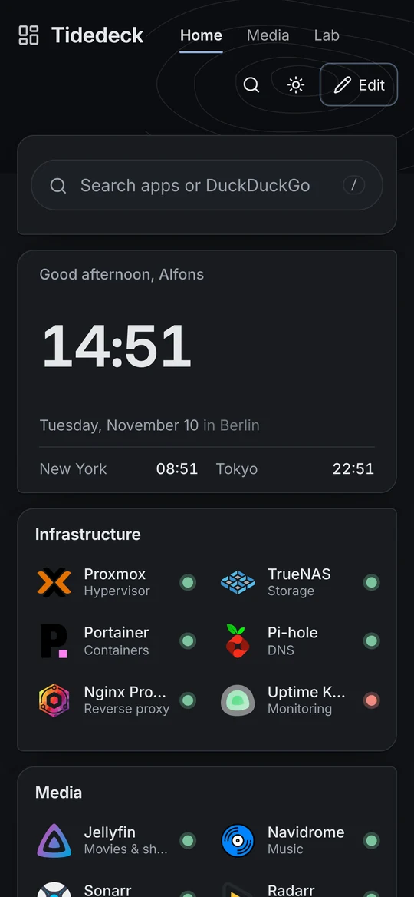
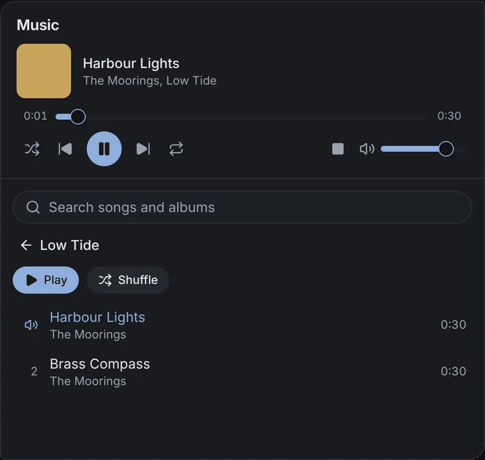

<p align="center">
  
</p>

<h1 align="center">Tidedeck</h1>

<p align="center">
  A self-hosted start page you build in the browser — no YAML, no restarts.<br>
  Drag, resize and arrange blocks; every change saves itself and shows up live in every open tab.
</p>

<p align="center">
  <a href="https://github.com/Pragma-1/tidedeck/actions/workflows/ci.yml"></a>
  <a href="https://hub.docker.com/r/astaldoo/tidedeck"></a>
  <a href="https://hub.docker.com/r/astaldoo/tidedeck"></a>
  
  
  <a href="LICENSE"></a>
</p>

<p align="center">
  
</p>

Tidedeck belongs to the **Tide** family with [Tidewiki](https://github.com/Pragma-1/tidewiki): same typeface, palette, header band and light/dark switch, so the two feel like one toolset.

## Contents

- [Features](#features)
- [Quick start](#quick-start)
- [Configuration](#configuration)
- [Screenshots](#screenshots)
- [Using it](#using-it)
- [Music](#music)
- [Moving from another dashboard](#moving-from-another-dashboard)
- [Data and backups](#data-and-backups)
- [Security](#security)
- [Development](#development)
- [License](#license)

## Features

**Fast**

- The board is rendered by the server and is on screen with the page — nothing waits for scripts, nothing moves after loading. The editor, dialogs, the Markdown renderer and the music player are loaded only when they're used: the scripts a visitor needs to load the page are about 40 % smaller (quick launch and the like follow in the background once the page is idle).
- Clock and calendar arrive rendered in your own language and time zone from the second visit on (a small `td_locale` cookie holds the browser's locale and time zone; nothing else).

**Building the board**

- Edit right on the page: click **Edit**, then drag blocks, pull any corner or edge to resize, double-click for settings. Nothing to restart, no config file to write.
- A fine grid — 48 columns and 9 px rows, so blocks line up exactly while the gaps stay even — that grows in every direction: push a block past the right or left edge and the page gets wider, like it gets longer downwards.
- Free placement: blocks stay exactly where you drop them, gaps included — nothing floats up. Widen one and its neighbours get narrower instead of jumping underneath; drag a block into a smaller gap and it fits itself in. Blocks that had to make way go back to their spot once there's room again.
- Several **boards** as tabs, and separate layouts for desktop, tablet and phone (generated from the wider one until you arrange them).
- **Live sync:** an edit in one tab appears in every other open tab and device. Conflicting edits are detected, never silently overwritten.
- Undo for removed blocks, duplicate blocks, copy or move blocks and single apps to other boards (or into another app group), automatic backups.

**Blocks**

| Block | What it does |
| --- | --- |
| App / App group | Links to your services as tiles, a list or compact bookmark chips. Status dot with response time, order custom (drag), A–Z, Z–A or random |
| Search | Filters your apps while you type, or searches the web; understands search shortcuts like `!yt lofi` |
| Clock | Any time zone, 12/24 h, optional greeting and extra world clocks |
| Calendar | Month view |
| Weather | Open-Meteo (no key), OpenWeatherMap, WeatherAPI.com, Google Weather or Apple Weather; find the place by name |
| Server resources | CPU, memory, disk and uptime of the host |
| RSS feed | Merges RSS/Atom feeds; fills in GitHub releases, YouTube channels and subreddits by name |
| Notes | Markdown with tables, task lists and links |
| Checklist | A to-do list you tick off right on the dashboard |
| Music | A full Navidrome/Subsonic player, or Spotify, YouTube and Deezer embeds |
| Embedded page | Any page that allows being embedded (Grafana, Uptime Kuma status pages …) |

**Getting around**

- **Quick launch** (`Ctrl/⌘+K`, or just start typing): every app on every board, typed addresses (`nas.lan:5000`), search shortcuts and web search in one box.
- Open apps in a new tab, the same tab, or **on top of the dashboard**; right-click any app for all options, Alt+click for the overlay.
- **Wall screen mode** (`?kiosk`): no header or edit button, optional rotation through boards, the pointer hides when idle.
- Installable as an app on phones and desktops.

**Looks and size**

- 29 presets in four groups (Tide, colour schemes like Nord, Dracula, Gruvbox and Catppuccin, styles like Synthwave, Terminal and Typewriter, sea and nature looks) and 27 self-hosted fonts; accent colour, font, background colour/gradient/image, header band, block opacity and custom CSS on top.
- **Fits big screens:** the whole dashboard scales with the screen by default (125 % on a 2560 px monitor, about 190 % on 4K), and browser zoom works on top. Adjust it, fix it, or give one device — the TV — its own size.
- **Module zoom:** zoom the content of any block from 50 to 250 % without changing its place on the grid (`Ctrl`+scroll in edit mode). A zoomed-out block can then also be made smaller.
- Icons from [selfh.st/icons](https://selfh.st/icons/) and [dashboard-icons](https://github.com/homarr-labs/dashboard-icons) with a searchable picker, your own uploads, or the site's favicon.

**Operations**

- One small container, one `./data` folder, no database. Runs as an unprivileged user (`PUID`/`PGID`) with a read-only file system and no capabilities.
- Admin password with a one-time setup code from the log; optional private mode (sign-in required to view).
- Status checks run on the server, so internal hosts and self-signed HTTPS work.
- Import from **Homepage**, **Dashy** and **Homer**.

## Quick start

You need Docker with the Compose plugin.

1. Put [`docker-compose.yml`](docker-compose.yml) and a copy of [`.env.example`](.env.example) named `.env` into an empty folder:

   ```bash
   curl -fsSLO https://raw.githubusercontent.com/Pragma-1/tidedeck/main/docker-compose.yml
   curl -fsSL -o .env https://raw.githubusercontent.com/Pragma-1/tidedeck/main/.env.example
   ```

2. Edit `.env` — at least `PORT` (the port you open in the browser).
3. Start it and read the one-time setup code from the log:

```bash
docker compose up -d
docker logs tidedeck
```

Open `http://<host>:<PORT>`, click **Edit**, enter the setup code and choose the admin password. That's it.

> Anyone who can open the page can _look_ at the dashboard, including app addresses. Only you can change it. If it's reachable from the internet, turn on **Settings → General → Require sign-in to view**, or put it behind your proxy's login.

**Updating:** `docker compose pull && docker compose up -d`. Layouts and settings from older versions are converted automatically.

**Behind a reverse proxy or Cloudflare Tunnel:** point it at `http://<host>:<PORT>`. Nothing else to set; keep the port itself on your LAN.

## Configuration

Everything about the dashboard is set in the browser. The environment only covers the container:

| Variable | Default | |
| --- | --- | --- |
| `PORT` | – | Host port (`${PORT}:3000` in the compose file). Required |
| `PUID` / `PGID` | `1000` | User the server runs as, and owner of `./data`. `0` (root) is refused |
| `ADMIN_PASSWORD` | – | Sets the password on first start instead of the setup code; ignored once a password exists |
| `AUTH_DISABLED` | – | `true` lets everyone edit. Only behind a proxy that does the sign-in |
| `DATA_DIR` | `/app/data` | Where the data lives inside the container |

The compose file runs the container hardened: `no-new-privileges`, all capabilities dropped except the five the entrypoint needs to hand `./data` to `PUID:PGID`, read-only root file system, `/tmp` as tmpfs.

## Screenshots

<table>
  <tr>
    <td></td>
    <td></td>
  </tr>
  <tr>
    <td align="center">Edit mode</td>
    <td align="center">Quick launch</td>
  </tr>
  <tr>
    <td></td>
    <td></td>
  </tr>
  <tr>
    <td align="center">Presets, size and page width</td>
    <td align="center">Block settings</td>
  </tr>
  <tr>
    <td></td>
    <td></td>
  </tr>
  <tr>
    <td align="center">Light theme</td>
    <td align="center">Wall screen at 2560 px</td>
  </tr>
</table>

<p align="center">
  
  &nbsp;
  
</p>

## Using it

| Key | |
| --- | --- |
| `Ctrl/⌘+K` | Quick launch |
| `/` | The board's search block (quick launch if there is none) |
| `e` | Edit mode on/off (`Shift+E` when "Start typing anywhere" is on) |
| `Esc` | Leave edit mode, close a dialog, leave wall-screen mode |
| `!key words` | Search shortcut, e.g. `!yt`, `!gh`, `!w` — editable under Settings → General |
| `Ctrl+Enter` / `Alt+Enter` | In search and quick launch: open in a new tab / on top of the dashboard |

- **Status lights** — green: answered (login pages count), red and pulsing: no answer or a server error, empty ring: not checked yet. Hover for the response time. A different address than the link can be checked, e.g. an internal IP or `/health`.
- **Sizes** — Settings → Look → Size: _Fit the screen_ (default) or _Fixed_, page width Standard/Wide/Full, and _Only on this device_ for a screen that needs its own size.
- **Module zoom** — the slider in a block's settings, or `Ctrl`+scroll / pinch over the block in edit mode. Kept per screen size; the percentage in the block's toolbar resets it.
- **Wall screen** — Settings → General → Wall screen copies a link like `/?board=home&kiosk&rotate=60`. A double-click in the top-left corner brings the header back.

## Music

**Navidrome / Subsonic** is a full player inside the dashboard: search, albums, playlists, recently played and random; play, shuffle, repeat, seek, stop. Media keys and the phone's lock screen work, plays are scrobbled, and playback continues while you switch boards or edit. Audio and covers stream through Tidedeck, so it also works when Navidrome is only reachable inside your network; the bitrate can be lowered for mobile data. Sign in with a username and password or an OpenSubsonic API key — stored encrypted on the server, never sent to the browser. By default only you can play; **Let visitors play music** opens it up.

**Spotify, YouTube / YouTube Music, Deezer** — paste a share link and the block shows the service's own player. Their limits: Spotify plays full songs only when you're signed in to spotify.com in the same browser; Deezer's embed plays 30-second previews of songs; YouTube Music can't be embedded, so its playlists play in the YouTube player (privacy-enhanced `youtube-nocookie.com`).

## Moving from another dashboard

Settings → Backup → **Import from another dashboard** reads:

- **Homepage** — `services.yaml` and `bookmarks.yaml`
- **Dashy** — `conf.yml` (sections and pages)
- **Homer** — `config.yml`

Groups become app groups on a new board, with names, links, descriptions and the way links open. Icons from dashboard-icons (`name.png`, `hl-name`) and selfh.st (`sh-name`) carry over; others fall back to the site's favicon. Service widgets and API integrations of those dashboards have no equivalent and are left out.

## Data and backups

Everything lives in `./data`:

| | |
| --- | --- |
| `dashboard.json` | Boards, blocks and settings. Written atomically; a damaged file is replaced by the newest valid backup |
| `backups/` | The last 20 versions, one every five minutes while you edit |
| `auth.json` | scrypt password hash and the session key (mode 600) |
| `secrets.json` | Logins for connected services, AES-256-GCM encrypted (mode 600). Not part of exports |
| `icons/` | Uploaded icons, named by content hash |

Settings → Backup exports and restores everything as one `.json` file. To move to another machine, copy the `data` folder.

## Security

Details, and how to report a vulnerability: [SECURITY.md](SECURITY.md). In short:

- scrypt password hashes, HMAC-signed `HttpOnly` cookies, revocable everywhere; a one-time setup code so nobody who merely reaches the page can claim it; escalating lock-out after wrong passwords.
- Same-origin JSON and Fetch Metadata checks on every change; per-request CSP nonces with `strict-dynamic`; API answers sandboxed.
- The server only contacts addresses saved in the dashboard, with size limits on everything it reads and no redirects to other schemes. `javascript:`/`data:` links are refused everywhere.
- Uploads are checked by their bytes; SVGs are served sandboxed. Markdown never renders HTML.

## Development

```bash
npm ci
npm run dev            # http://localhost:3000, data in ./data
npm run check          # TypeScript
npm run build          # production build (standalone)
```

The production server is `.next/standalone/server.js`; copy `.next/static` and `public` next to it, as the [Dockerfile](Dockerfile) does. See [CONTRIBUTING.md](CONTRIBUTING.md).

Built with Next.js 16 (App Router), React 19, TypeScript, Tailwind CSS 4, Radix UI, react-grid-layout, dnd-kit, zod and zustand. Fonts are bundled; nothing is loaded from Google.

## License

[MIT](LICENSE). Icons shown in the picker come from [selfh.st/icons](https://selfh.st/icons/) (CC BY 4.0) and [dashboard-icons](https://github.com/homarr-labs/dashboard-icons) and are loaded from their CDNs, not bundled.
